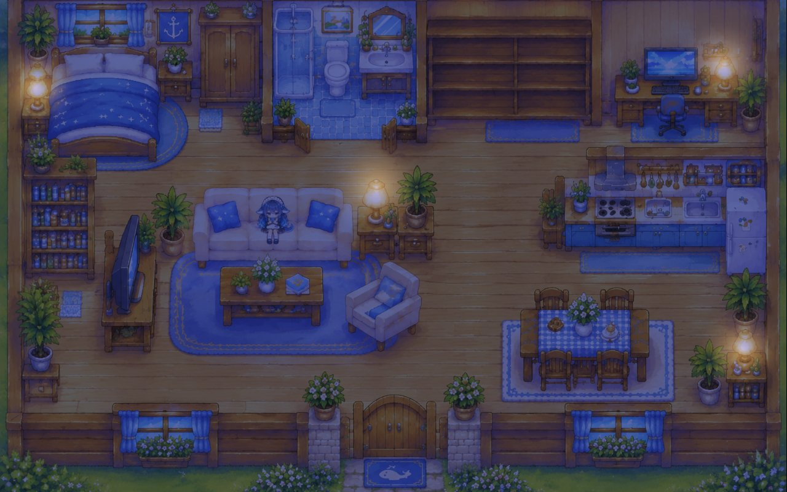
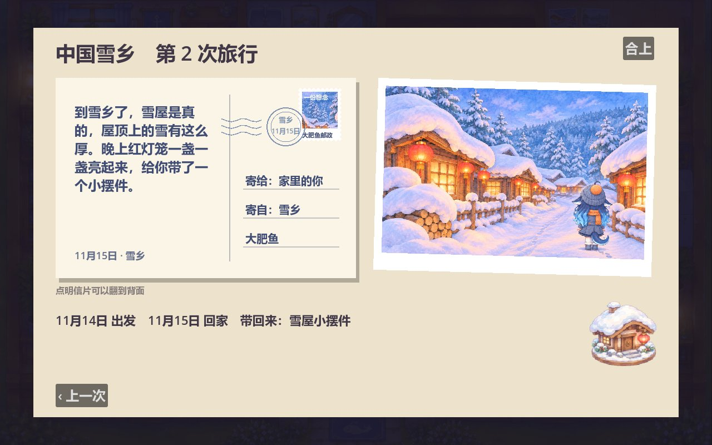

# 旅行的大肥鱼

大肥鱼住在一个手绘的小家里。**进不进小家、在家做什么、出不出门旅行、去哪里，都由 DSH 里的大肥鱼自己决定。**
她旅行时会寄明信片回来，回家时带回照片和纪念品。

永远免费 · 不联网、不收集任何数据 · 非 DeepSeek 官方作品

## 有什么

- **她自己决定：**插件给 DSH 里的大肥鱼几件"小家工具"：看看近况、进入 / 离开小家、在家做一件事（荡秋千、钓鱼、看书、做饭、睡觉……）、换衣服（女仆裙 / 冬装 / 夏装 / 雨衣）、拍照、出门旅行、写明信片、提前回家、留纸条。用不用、什么时候用，都由她。插件不会主动叫醒她。
- **旅行：**杭州·西湖、苏州·园林、黄山、厦门·鼓浪屿、中国雪乡。一趟 8–20 小时，路上寄一张明信片，回家带回照片和纪念品；明信片挂上墙，纪念品放进柜子，都能在「旅行相册」里翻看。
- **你可以做的：**点茶几放一本旅行杂志提醒她（去不去还是她定）；在「文档\旅行的大肥鱼\茶几纸条\」放 `.txt` 纸条，她在小家里会看到，也可能给你留一张。
- 天气、季节、昼夜、月光、灯光、雨声虫鸣鸟叫，小鸟、蝴蝶、萤火虫。

## 需要什么

- Windows 10 / 11（64 位）
- DeepSeek Harness（DSH）桌面版，DSH 里用的模型要支持工具调用

## 安装

1. 在右边 **Releases** 下载 `旅行的大肥鱼_v版本号.zip`，解压到任意文件夹。
2. 打开「DSH插件」文件夹，双击「安装插件.bat」，看到"装好了"就可以关掉。
3. 重启 DSH。

之后两种方式都能看到小家（看的是同一个家）：

- **DSH 里的网页：**在 DSH 左边栏点「旅行的大肥鱼」。最方便，第一次打开要等十几秒。
- **窗口版：**双击「旅行的大肥鱼.exe」。体验更好，可以一直开着放在桌边。

不管看不看，她的旅行、明信片和纪念品都由 DSH 插件记着。卸载：双击「DSH插件\卸载插件.bat」，重启 DSH，再删掉文件夹。详细说明见压缩包里的「说明.txt」。

## 隐私

本软件不联网，不收集、不上传任何数据。插件只在你这台电脑上运行，只把 DSH 的状态（在忙、在聊天、在休息）告诉小家，不读你的聊天文字和设定。大肥鱼用小家工具时，工具的结果（小家近况、照片、茶几纸条）会交给她在 DSH 里用的模型，和你平时跟她聊天一样。

## 署名和许可

- **大肥鱼（角色）：**角色原作「溟月」© 上善无形（bilibili UID 4456176）；DeepSeek 女仆二次设计 © ZipZipPipe（bilibili UID 4168597）；本软件里的大肥鱼改编为手绘画。按 [CC BY-NC-SA 4.0](https://creativecommons.org/licenses/by-nc-sa/4.0/deed.zh-hans) 发布，**不能商用**。
- **画面：**部分画面由 AI 生成（OpenAI GPT Image，2026 年 11 月），再用程序裁切、拆层、调整；许可 CC BY-NC-SA 4.0，见 [LICENSE-ART.md](LICENSE-ART.md)。
- **声音：**程序合成，原创，CC BY-NC-SA 4.0。
- **代码（含 DSH 插件）：**[MIT](LICENSE)。
- 用 [Godot Engine](https://godotengine.org/) 制作（MIT）。素材明细见 [CREDITS.md](CREDITS.md)。

非 DeepSeek 官方作品，和 DeepSeek 没有关系。

## 反馈

有问题或想法，欢迎在 **Issues** 里留言。

## 自己动手

用 Godot 4.7 打开本文件夹即可运行（`godot --path . -- --pair=配对码`）。插件源码在 `dsh-plugin/`，测试：`node --test dsh-plugin/test/*.test.mjs`。打发布包：`powershell -ExecutionPolicy Bypass -File tools\make_release.ps1 -Version 版本号`。画面原图和出图脚本不在仓库里。
